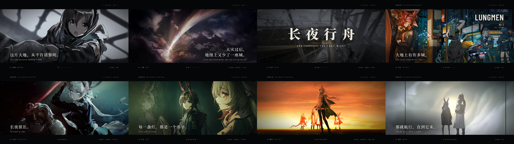

# 长夜行舟 · ARK THROUGH THE LONG NIGHT

一部《明日方舟》同人短片，2 分 52 秒，1920×1080 / 30 fps。

成片：[`out/long-night-ark.mp4`](out/long-night-ark.mp4)

> 这片大地，从不许诺黎明。
> 那就航行，直到它来。



本片为**非官方、非商业**的同人作品。画面取自明日方舟官方网站公开的画廊图像，配乐为塞壬唱片发行的
《曙光》（明日方舟：黎明前奏 OST）；相关版权均归鹰角网络（Hypergryph）及原权利人所有。
仓库里**不包含**任何官方素材本体，只有成片与制作它的代码；素材在构建时从官方服务器现取。

## 它讲了什么

全片是一首八行的小诗，八个章节，画面右下角标注着每一张图在官方画廊里的名字。

| # | 章节 | 时间 | 内容 |
|---|------|------|------|
| 00 | 苏醒 AWAKENING | 0:00 | 黑暗、心电图、眼睑睁开——第一眼看见的是一只伸过来的手 |
| 01 | 大地 TERRA | 0:15 | 源石，然后是天灾。音乐停顿的两秒里只有一句话：「于是，有人造了一艘船。」 |
| 02 | 行舟 THE ARK | 0:29 | 第一个重拍：从甲板上的一个人拉远到整座陆行舰，片名四个字各落在一拍上 |
| 03 | 众生 THE PEOPLE | 0:43 | 龙门、企鹅物流、莱茵生命、谢拉格、乌萨斯、卡西米尔——一小节一座城 |
| 04 | 长夜 THE LONG NIGHT | 0:57 | 两小节一个镜头，压低饱和、提高反差，切点带震动与刀光 |
| 05 | 灯火 LAMPS | 1:24 | 音乐回落，改用慢叠化；「每一盏灯，都是一个名字。」 |
| 06 | 曙光 FIRST LIGHT | 1:52 | 高潮：色彩第一次完全放开 |
| 07 | 航行 ONWARD | 2:19 | 两个人站在窗前；光从他们之间漫出来，直到整块银幕变成黎明 |

## 几个取舍

- **颜色就是剧情。** 开头近乎黑白，饱和度随章节一点点放开，到「曙光」才给全彩；
  结尾不是「淡出到黑」，而是银幕本身亮成一张米白的纸——长夜之后，画面自己成了黎明。
- **剪辑贴着乐谱走。** 《曙光》是 140 BPM，第一个重拍在 29.79 秒；所有切点都由 `bar(n)` 算出，
  没有一个时间是凭感觉填的。画面右上角的 `BAR 049` 就是此刻的小节号。
- **一盏灯对应一章。** 画面底部的八个小方块是八盏灯，每过一章亮起一盏；片尾八盏全亮。
- **克制。** 一种衬线字（旁白）、一种窄体字（地名与英文）、一种等宽字（仪表读数），一个琥珀色强调色。
  不加转场特效包，不加贴纸；能用留白解决的就不加东西。

## 它是怎么做出来的

没有用任何剪辑软件。整部片子是一个纯函数：

```js
Film.render(ctx, t)   // 把第 t 秒的画面画到一张 1920×1080 的 canvas 上
```

帧与帧之间不保留任何状态，所以任意一帧都能单独、乱序地渲染——`tools/render.mjs` 就是借此开四个
无头浏览器页面并行出帧，再交给 ffmpeg 与配乐合成。

```
src/film.js           影片本体：分镜表、运镜、调色、字幕、仪表、粒子、片尾
src/render.html       载入字体与素材的页面（加 #play 可实时预览并拖动时间轴）
tools/prep_assets.py  按 assets.json 从官方服务器取图取曲；早期低清壁纸用 Real-ESRGAN 放大 4 倍
tools/upscale.py      放大器（RRDBNet / anime-6B 权重）
tools/render.mjs      逐帧渲染 + 合成
assets.json           素材清单：每张图的官方出处与画廊标题
```

### 重新构建

需要 Node 18+、Python 3.10+、ffmpeg，以及 Playwright 自带的 Chromium。

```bash
npm install                                   # 字体（Noto Serif/Sans SC、Barlow Condensed、JetBrains Mono，均为 OFL）
pip install pillow torch                      # torch 只用于放大那 16 张旧壁纸
python3 tools/prep_assets.py                  # 取素材 → assets/
node tools/render.mjs --still 31 112 150      # 抽几帧看看 → out/stills/
node tools/render.mjs                         # 全片 → out/long-night-ark.mp4（四核约十分钟）
```

## 致谢

- 画面：明日方舟官方网站画廊（主线「相变临界」CG、早期官方壁纸、「重启锚点」主视觉）© 鹰角网络
- 音乐：《曙光》，明日方舟：黎明前奏 OST，塞壬唱片 Monster Siren Records
- 放大模型：Real-ESRGAN（anime-6B）
- 分镜、文案、动态设计与代码：Claude
